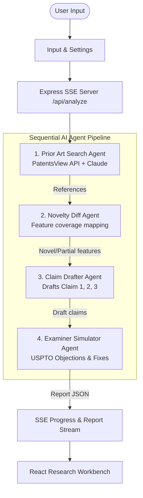

# Agentic Research Assistant 🔬

An AI-powered patent & research analysis pipeline for hackathon demos and patentability assessment.

## Architecture



## How It Works

1. **Prior Art Search Agent**: Converts your idea into key technical queries, searches PatentsView API for real US patents, and scores relevance 0-100.
2. **Novelty Diff Agent**: Deconstructs your invention into key technical features and marks each feature as `Covered`, `Partial`, or `New` against retrieved prior art.
3. **Claim Drafter Agent**: Drafts 1 broad independent claim and 2 dependent claims strictly using only `New` and `Partial` features to avoid claiming prior art.
4. **Examiner Simulator Agent**: Acts as a USPTO patent examiner to surface 102/103 obviousness and 112 clarity/enablement objections, complete with suggested fixes and filling recommendations.

---

## Quick Start (Mock Mode - No API keys needed!)

`MOCK_MODE=true` is enabled by default in `server/.env`.

```bash
# 1. Install dependencies across root, server, and client
npm run install:all

# 2. Run both server and client concurrently
npm run dev
```

Open [http://localhost:5173](http://localhost:5173) in your browser.

---

## Live Claude API & PatentsView Mode

To run with live Claude AI:

1. Copy `.env.example` to `server/.env`
2. Set `MOCK_MODE=false`
3. Add your `ANTHROPIC_API_KEY=sk-ant-...`
4. (Optional) Add your `PATENTSVIEW_API_KEY` for higher rate limits on PatentsView searches.

```bash
npm run dev
```

---

## Tech Stack

- **Backend**: Node.js, TypeScript, Express, Server-Sent Events (SSE), `@anthropic-ai/sdk`, `zod`
- **Frontend**: React 18, Vite, Tailwind CSS, TypeScript, IBM Plex Sans & Source Serif 4 fonts
- **LLM**: Anthropic Claude API (`claude-sonnet-4-6`)
- **Data Source**: PatentsView REST API
